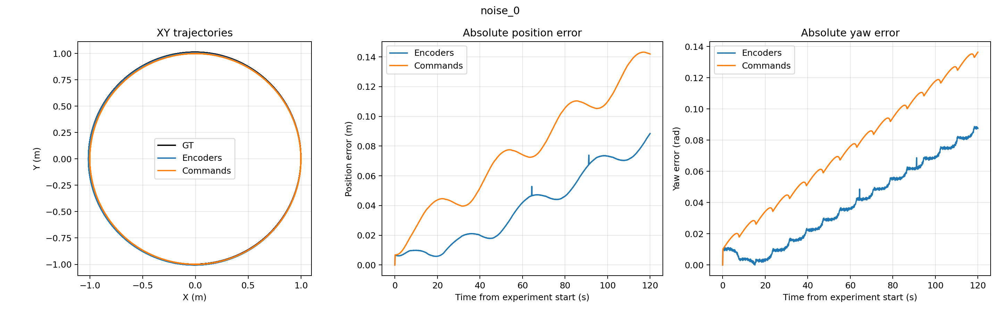
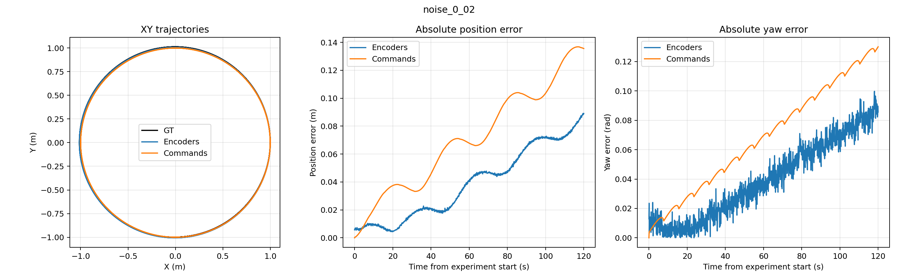
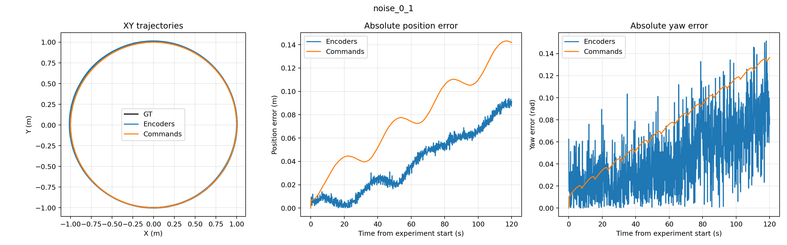

# Практическая работа №3. Одометрия и системы координат

В Webots сравниваются три траектории TurtleBot3: истинная поза из
супервизора (GT), колёсная одометрия по энкодерам и одометрия по командам
`/cmd_vel`. Пакет основан на [примере курса](../../examples/example_webots_odometry).

## Сборка и запуск

Запустите сервер связи с Webots на Mac. В контейнере с ROS 2 Jazzy
соберите пакет и подключите рабочее пространство:

```bash
cd /home/ezh/practices_ws
colcon build --packages-select practice03_odometry --symlink-install
source install/local_setup.zsh
cd /home/ezh/practices_ws/src/practice-03
```

Запускайте эксперименты по одному. После сообщения `Experiment completed.`
остановите текущий launch через Ctrl+C и убедитесь, что его драйверы
завершились. Сервер связи на Mac можно оставить запущенным.

```bash
ros2 launch practice03_odometry spawn_robot.launch.py world:=my_world.wbt experiment_name:=noise_0
ros2 launch practice03_odometry spawn_robot.launch.py world:=noise_0_02.wbt experiment_name:=noise_0_02
ros2 launch practice03_odometry spawn_robot.launch.py world:=noise_0_1.wbt experiment_name:=noise_0_1
```

По умолчанию `duration` равен 120 секундам симуляции, а `output_dir` указывает
на папку `results` относительно текущего каталога. В каждом запуске
публикуются одинаковые команды: линейная скорость 0.2 м/с и угловая скорость
0.2 рад/с. Для колёсного контроллера используется `wheel_separation_multiplier = 1.1`.
В сценах меняется только поле `encoderNoise`.

## Метод сравнения

Сборщик получает GT и колёсную оценку через `tf2` в системе `map` на одну
временную метку. Траектория по командам начинается с первой позы GT и дальше
вычисляется интегрированием скоростей из `/cmd_vel` по времени симуляции.
Ошибка положения — расстояние между точками на плоскости XY. Ошибка
ориентации — абсолютная кратчайшая разность углов рысканья.

## Результаты

Каждый запуск дал 1201 измерение за 120 секунд симуляции. Для каждого
эксперимента сохранены CSV с измерениями, PNG с графиками и JSON с метриками.

| Шум, рад | RMSE положения, энкодеры (м) | RMSE угла, энкодеры (рад) | RMSE положения, команды (м) | RMSE угла, команды (рад) |
| ---: | ---: | ---: | ---: | ---: |
| 0 | 0.0463 | 0.0471 | 0.0857 | 0.0831 |
| 0.02 | 0.0464 | 0.0475 | 0.0800 | 0.0774 |
| 0.1 | 0.0473 | 0.0543 | 0.0857 | 0.0831 |

### Шум 0 рад



### Шум 0.02 рад



### Шум 0.1 рад



## Анализ

При шуме 0.02 рад ошибки колёсной одометрии почти не изменились. При
0.1 рад RMSE угла выросла с 0.0471 до 0.0543 рад (примерно на 15%),
а RMSE положения — с 0.0463 до 0.0473 м (примерно на 2%). В этих запусках
добавленный шум заметнее сказался на оценке ориентации.

У колёсной одометрии есть ошибка даже при нулевом добавленном шуме.
Возможные причины — контакт колёс с поверхностью и расхождение параметров
кинематической модели с фактическим движением. Оценка по командам
предполагает, что робот идеально выполняет заданные скорости. В запуске
без шума этот способ дал большую ошибку, чем одометрия по энкодерам,
и по положению, и по углу.
