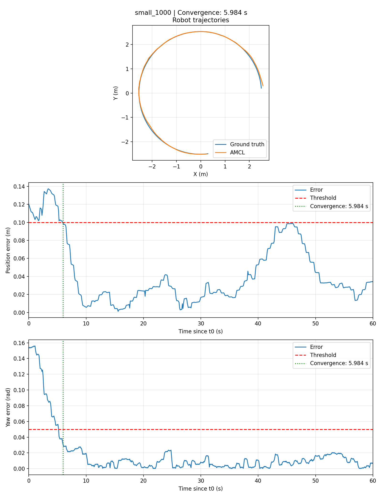
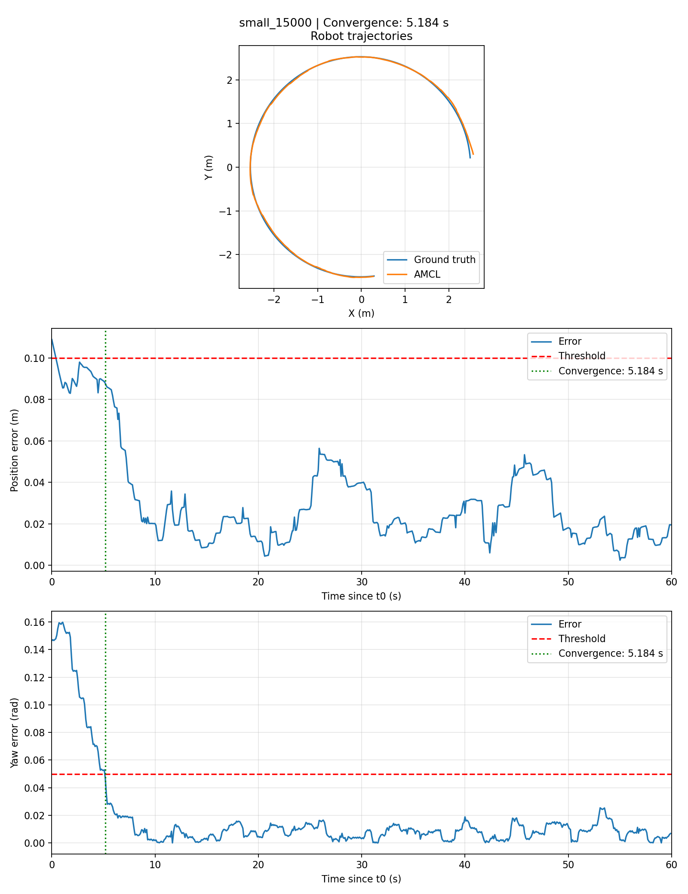
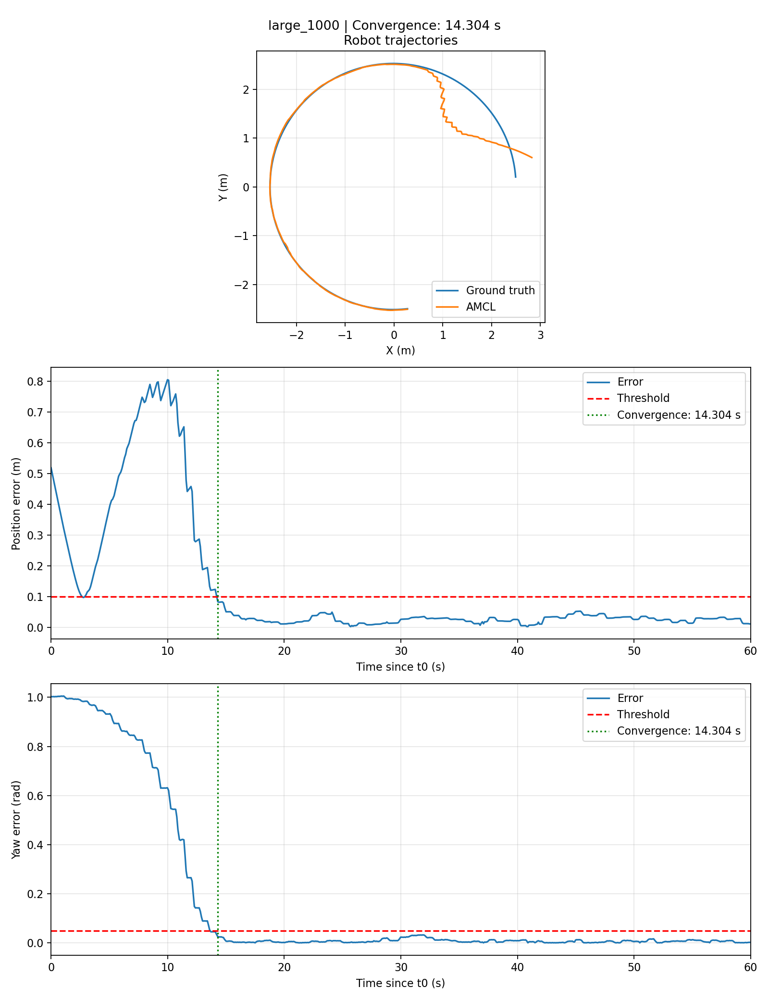
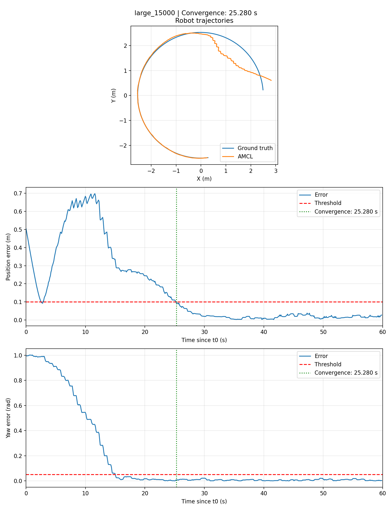
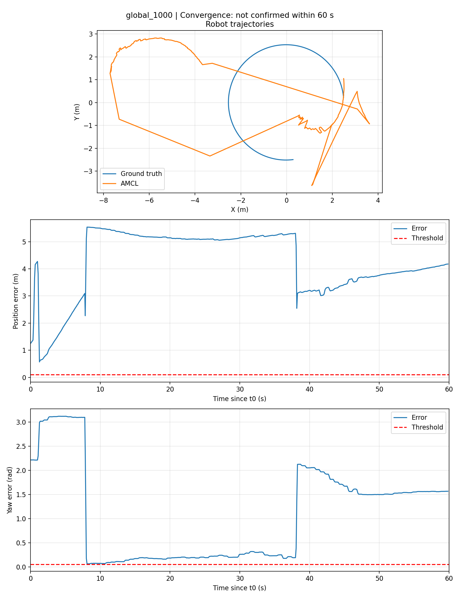
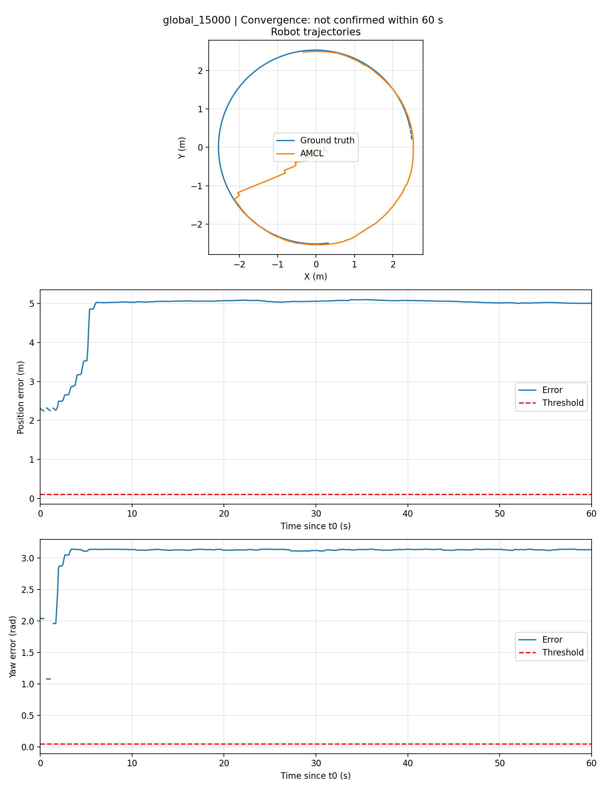

# Практическая работа 4. Локализация по известной карте

Ежов Иван Максимович, вариант 03.

## Решение

Пакет `webots_localization_03` создан на основе примера курса.
Webots R2025a работает на Mac, ROS 2 Jazzy — в Docker внутри Ubuntu.

Площадка 8 × 8 м содержит стены и цифры 0 и 3.
Высота цифр — 0,4 м. Разрешение карты — 0,01 м/пиксель.
Система map совпадает с глобальной системой координат сцены.

Начальная поза робота: X = 2,5 м, Y = 0 м, yaw = pi/2 рад.
Команды движения: 0,2 м/с и 0,08 рад/с.
В предварительных запусках по 240 с проверено несколько кругов без столкновений.

## Протокол

Итоговое окно наблюдения — 60 секунд симуляции, режим Real-time.
Пороги ошибок: 0,10 м и 0,05 рад, подтверждение — 10 секунд.
Подтверждающий интервал должен полностью помещаться в эти 60 секунд.
Продолжительность выбрана по предварительным запускам длительностью 240 с.
Отсутствие сходимости за 60 с не означает невозможность сходимости позднее.

min_particles = 500 в обоих режимах; max_particles = 1000 или 15000.
Малая ошибка: dX = 0,1 м, dY = 0,1 м, dyaw = 0,15 рад.
Большая ошибка: dX = 0,5 м, dY = 0,5 м, dyaw = 1 рад.
При глобальной локализации начальная догадка не задаётся.

## Результаты

| Инициализация | max_particles | Сходимость |
|---|---:|---|
| Малая ошибка | 1000 | 5.984 с |
| Малая ошибка | 15000 | 5.184 с |
| Большая ошибка | 1000 | 14.304 с |
| Большая ошибка | 15000 | 25.280 с |
| Глобальная локализация | 1000 | Не подтверждена за 60 с |
| Глобальная локализация | 15000 | Не подтверждена за 60 с |

### Малая ошибка, max_particles = 1000



### Малая ошибка, max_particles = 15000



### Большая ошибка, max_particles = 1000



### Большая ошибка, max_particles = 15000



### Глобальная локализация, max_particles = 1000



### Глобальная локализация, max_particles = 15000



## Сборка и запуск

Используется подготовленная среда курса.
Webots работает на Mac, ROS 2 — в Docker внутри Ubuntu.
На Mac должен работать один экземпляр сервера связи.

Если сервер остановлен, в терминале macOS:

```bash
export WEBOTS_HOME="$HOME/webots-R2025a"
python3 ~/local_simulation_server.py
```

Сборка внутри Docker, в Bash:

```bash
source /opt/ros/jazzy/setup.bash
cd /home/ezh/practices_ws
colcon build --packages-select webots_localization_03
source install/setup.bash
```

Ниже выполняется одна команда выбранного эксперимента.
В Webots необходимо использовать Real-time.
По умолчанию пороги равны 0,10 м и 0,05 рад, подтверждение — 10 с.

### Запуск small_1000

```bash
ros2 launch webots_localization_03 spawn_robot.launch.py mode:=realtime localization_mode:=initial min_particles:=500 max_particles:=1000 duration:=60.0 run_id:=reproduce_small_1000_01 error_x:=0.1 error_y:=0.1 error_yaw:=0.15
```

### Запуск small_15000

```bash
ros2 launch webots_localization_03 spawn_robot.launch.py mode:=realtime localization_mode:=initial min_particles:=500 max_particles:=15000 duration:=60.0 run_id:=reproduce_small_15000_01 error_x:=0.1 error_y:=0.1 error_yaw:=0.15
```

### Запуск large_1000

```bash
ros2 launch webots_localization_03 spawn_robot.launch.py mode:=realtime localization_mode:=initial min_particles:=500 max_particles:=1000 duration:=60.0 run_id:=reproduce_large_1000_01 error_x:=0.5 error_y:=0.5 error_yaw:=1.0
```

### Запуск large_15000

```bash
ros2 launch webots_localization_03 spawn_robot.launch.py mode:=realtime localization_mode:=initial min_particles:=500 max_particles:=15000 duration:=60.0 run_id:=reproduce_large_15000_01 error_x:=0.5 error_y:=0.5 error_yaw:=1.0
```

### Запуск global_1000

```bash
ros2 launch webots_localization_03 spawn_robot.launch.py mode:=realtime localization_mode:=global min_particles:=500 max_particles:=1000 duration:=60.0 run_id:=reproduce_global_1000_01
```

### Запуск global_15000

```bash
ros2 launch webots_localization_03 spawn_robot.launch.py mode:=realtime localization_mode:=global min_particles:=500 max_particles:=15000 duration:=60.0 run_id:=reproduce_global_15000_01
```


## Расчёт ошибок и сходимости

Супервизор публикует истинную позу в map -> base_link_gt.
Оценка AMCL получается через map -> odom -> base_link.
Статический map -> odom не публикуется.

Обе позы считываются через TF2 в один момент времени:
по времени последней доступной колёсной одометрии.
Ошибка положения — евклидово расстояние между позициями.
Ошибка yaw — абсолютная минимальная разность углов в пределах [0, pi].

t0 определяется по первой доступной паре синхронизированных поз
после готовности AMCL и завершения выбранной инициализации.
Глобальная инициализация выполняется сборщиком через
/reinitialize_global_localization.

Сходимость подтверждается, когда обе ошибки одновременно
не превышают пороги непрерывно в течение 10 с.
При нарушении порога или промежутке между измерениями более 0,3 с
интервал подтверждения начинается заново.
Время сходимости — начало первого подтверждённого интервала.
Подтверждение должно завершиться до конца окна наблюдения 60 с.

Узел description_filter передаёт контроллерам только описание
робота с блоком ros2_control. Это исключает случайный приём
временного описания без интерфейсов колёс при запуске.

## Анализ результатов

При малой начальной ошибке время сходимости составило 5,984 с
для max_particles=1000 и 5,184 с для max_particles=15000.

При большой начальной ошибке получены 14,304 с и 25,280 с
соответственно. В этих запусках большая ошибка начальной догадки
потребовала больше времени для достижения заданной точности.

При глобальной локализации сходимость не подтвердилась за 60 с
в обоих режимах числа частиц.

Для глобального запуска с max_particles=15000 наблюдались ошибка
положения около 5 м и ошибка направления около pi рад.
Это согласуется с неверной гипотезой о противоположной позе
на окружности радиусом 2,5 м. Геометрические формы траекторий
могут совпадать, хотя позы в одинаковые моменты времени различаются.

Выполнено по одному итоговому запуску каждой комбинации.
AMCL использует случайные частицы, поэтому эти результаты
не доказывают общего преимущества одного числа частиц над другим.

## Сохранённые данные

Итоговые результаты находятся в results/final60.
Для каждой комбинации сохранены data.csv, summary.json и plots.png.
Сводная таблица — results/final60/comparison.csv.

Для small_1000 и global_15000 использованы первые 60 с
полных записей Real-time продолжительностью 240 с.
Остальные четыре эксперимента записаны непосредственно по 60 с.
Сходимость всех шести наборов пересчитана единым скриптом
webots_localization_03/scripts/analyze_results.py.
Подтверждающий интервал целиком ограничен первыми 60 секундами.

Исходные данные сохранены отдельно без изменений.
Имена исходных запусков указаны в поле source_run_id итоговых JSON.
Предварительные запуски Fast в итоговую таблицу не включены.

Скрипт анализа требует исходные записи и создаёт results/final60.
При наличии этой папки он останавливается без перезаписи.
На итоговых графиках пропуски более 0,3 с показаны разрывами линий.
Максимальный промежуток итогового global_15000 равен 0,32 с;
он сбрасывает интервал подтверждения сходимости.

## Завершение и повторный запуск

Сборщик сохраняет результаты в
/home/ezh/practices_ws/src/practice-04/results/<run_id>/
и выводит Experiment finished. Симуляция продолжает работать до Ctrl+C.
Для нового запуска нужно уникальное run_id:
существующие результаты не перезаписываются.

Между запусками в используемой среде выполнялись команды
docker restart ros2-practice04 и docker exec -it ros2-practice04 bash
в обычном терминале Ubuntu. После входа заново подключалось
окружение ROS 2 и install/setup.bash рабочего пространства.
Сервер Webots на Mac оставался работать.
